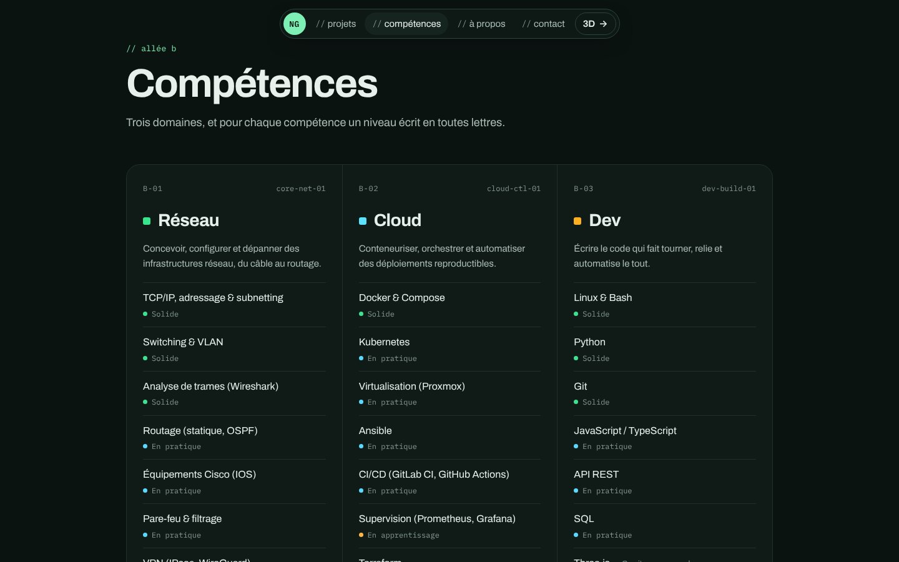
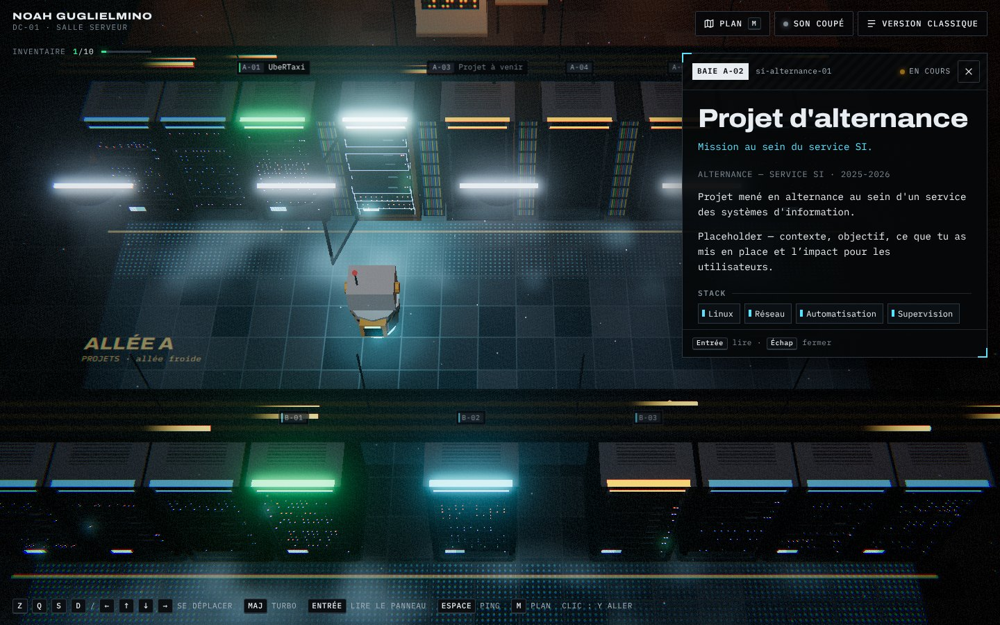

# DC-01 — portfolio de Noah Guglielmino

Un portfolio sur le thème de la **salle serveur**, en deux versions :
une page 2D courte et calme (une baie illustrée, des cartes projet avec écran, une couleur
d'ambiance), et au bout, une porte de sas qui ouvre sur la **salle 3D** où l'on pilote un robot
de maintenance.


| Projets | Compétences |
| --- | --- |
|  |  |

| Le sas vers la 3D | La salle 3D |
| --- | --- |
|  |  |

| Page | Rôle |
| --- | --- |
| `/` | **La page 2D complète**, HTML pré-rendu au build depuis `src/data/`. |
| `/cv/` | Le CV sur un « serveur legacy » (terminal ambre ; papier listing en thème clair). |
| `/3d/` | La salle serveur interactive (Three.js, chargée seulement ici). Accès : la porte en bas de `/`, ou le bouton « 3D » de la navigation. |
| `/classique/` | Ancienne adresse : redirige vers `/` (en gardant l'ancre `#projets`…). |

---

## Lancer en local

```bash
npm install
npm run dev        # http://localhost:5173
```

## Vérifier (avant chaque commit)

```bash
npm run build          # tsc --noEmit + vite build
npm run validate       # html-validate + validateur W3C Nu (Java 11 ou plus)
npm run budget         # JS de la page 2D, gzip, librairies comprises (échoue > 80 Ko)
npm run a11y           # axe-core sur / et /cv/, thèmes sombre et clair, avec et sans animations
npm run shots          # captures 1440×900, 390×844, reduced-motion, sans JS → ./shots/
npm run lighthouse     # Lighthouse desktop sur / et /cv/
```

`a11y`, `shots` et `lighthouse` pilotent le Edge ou le Chrome **déjà installé** (aucun navigateur
téléchargé) ; un autre chemin se donne avec `BROWSER_PATH=…`. Le site est servi sous `/portfolio_3d/`,
comme sur GitHub Pages.

## Ajouter / modifier un projet

Tout le contenu vit dans `src/data/` — **ni la page 2D ni la scène 3D ne se touchent** :

| Fichier | Contenu |
| --- | --- |
| `src/data/projects.ts` | Une entrée = une carte projet (2D) et une baie dans la salle (3D). |
| `src/data/skills.ts` | Un domaine = une colonne (2D) / une baie (3D) ; une compétence = une ligne avec son niveau. |
| `src/data/profile.ts` | Hero, À propos, contact, CV. |

```ts
// src/data/projects.ts
{
  id: 'mon-projet',               // ancre de la fiche : /#mon-projet (2D) et /3d/#mon-projet
  title: 'Mon projet',
  status: 'online',               // 'online' (LED verte) | 'building' (ambre) | 'slot' (baie vide)
  hostname: 'mon-projet-prod-01', // affiché dans l'écran de la carte
  tagline: 'Une phrase d’accroche.',
  description: 'Paragraphe 1.\n\nParagraphe 2.',
  context: 'SAE / alternance / perso',
  year: '2026',
  stack: ['Docker', 'Kubernetes'],
  highlights: ['Point clé 1', 'Point clé 2'],
  links: [{ label: 'Code source', url: 'https://github.com/…', kind: 'github' }],
  cover: 'projets/mon-projet.webp', // optionnel : capture dans public/projets/, format ~16:10
  coverAlt: 'Écran d’accueil de Mon projet',
},
```

Sans `cover`, l'écran de la carte affiche un terminal généré depuis les données (hostname,
statut, stack). Les emplacements `slot` sont regroupés en une seule carte « N emplacements libres ».
Le CV est un simple fichier : remplace `public/cv/CV-Noah-Guglielmino.pdf` (son poids est relu au build).

### À compléter (placeholders actuels)

- [ ] Textes, stack et liens d'**UbeRTaxi** et du **projet d'alternance** (`projects.ts`)
- [ ] Les 3 emplacements « Projet à venir » (passe-les en `online` quand ils existent)
- [ ] Niveaux de compétences (`skills.ts`) — listes indicatives
- [ ] Paragraphe « ce que je cherche », lien **LinkedIn**, **e-mail** (`profile.ts`)
- [ ] Le vrai **CV** en PDF (`public/cv/`, le fichier actuel fait 1 Ko)
- [ ] Les **captures** des projets (`cover` dans `projects.ts`, fichiers dans `public/projets/`)

## Structure

```
index.html               coquille de /  (<!--SITE--> remplacé au build)
cv/index.html            coquille de /cv/
classique/index.html     redirection vers /
3d/index.html            la salle 3D
src/data/                SEULE source de contenu
src/render/              rendu HTML statique, exécuté par Vite (Node) au build
  site.ts                  toutes les sections de / (dont la baie SVG du hero)
  cv.ts                    /cv/
  shared.ts                statuts, codes d'inventaire, liens externes
src/site/                page 2D côté navigateur
  boot.ts                  un seul petit script, sans librairie (~2 Ko gzip)
  site.css                 toute la page (thème sombre/clair, impression)
src/cv/                  styles de /cv/ (aucun JS utile)
src/three/               la salle 3D
scripts/                 vérifications (captures, axe, Lighthouse, budget)
```

## La page 2D

Une page courte et calme, inspirée des portfolios éditoriaux plutôt que des templates :
peu d'éléments, une couleur d'ambiance, des minuscules normales. Le thème datacenter est porté
par les détails (baie illustrée, écrans, LEDs d'état, étiquettes `A-01`, commentaires `//`),
pas par des effets.

| Bloc | Contenu |
| --- | --- |
| Navigation | Pilule flottante, liens en commentaires de code (`// projets`), bouton « 3D → ». Section courante surlignée. |
| Hero | Le nom seul, une ligne de rôle, une baie de serveurs illustrée en SVG dont les LEDs clignotent. |
| Projets | Cartes arrondies, deux par ligne : un écran (capture ou terminal), statut écrit, stack. « Voir le projet » ouvre la fiche complète dans un `<dialog>`. |
| Compétences | Trois colonnes (Réseau, Cloud, Dev), chaque compétence avec son niveau en toutes lettres. |
| À propos | Le texte du profil et les infos clés. |
| Contact | L'e-mail en grand (+ bouton copier), GitHub, LinkedIn, CV. |
| Sas | « Envie de voir la salle ? » : une porte qui s'entrouvre au survol et s'ouvre au clic vers `./3d/?choix=3d`. |

**Animations (volontairement peu nombreuses).**
- Le hero apparaît en fondu montant, puis la baie s'allume.
- Les blocs apparaissent doucement au scroll.
- Les cartes se soulèvent au survol.
- La porte s'ouvre.
- Les LEDs clignotent 5 s puis se figent (WCAG 2.2.2).

Tout est en CSS, plus un `IntersectionObserver` ; aucune librairie. Avec `prefers-reduced-motion`, rien ne bouge.

### Décisions

- **Le HTML est complet sans JS.** Tout est pré-rendu ; sans JS, le détail des projets est
  affiché directement dans les cartes.
- **Aucune librairie** : GSAP et Lenis ont été retirés avec l'ancienne version, trop chargée.
  JS de la page : ~2 Ko gzip.
- **Aucun contenu inventé** : tout vient de `src/data/` ; seuls des repères d'interface
  (A-01, B-01, « dc-01 ») sont ajoutés.
- **Sans WebGL 2** : la porte reste fermée (ce n'est plus un lien), avec un message clair, et le
  bouton « 3D » disparaît. `/3d/` sans WebGL renvoie sur `/` avec un avis.

## Dans la salle (3D)

| Action | Clavier | Souris / tactile |
| --- | --- | --- |
| Se déplacer | `ZQSD`, `WASD` ou flèches (AZERTY et QWERTY sans réglage) | glisser au doigt (joystick flottant) |
| Turbo | `Maj` | — |
| Aller vers une baie | `M` → plan de salle → `Entrée` | clic / tap sur la baie ou le sol |
| Lire le panneau | `Entrée` ou `E` | — |
| Fermer le panneau | `Échap` | bouton × |
| Ping | `Espace` | — |

Approche une baie : elle s'ouvre, ses serveurs glissent hors des rails et le panneau apparaît.
Il y a aussi un inventaire de visite, des liens directs vers chaque baie (`/3d/#ubertaxi`)… et une commande à ne pas taper.

## Sous le capot (3D)

- **Vite + TypeScript + Three.js** sans framework (le repo n'était pas en React → pas de R3F,
  bundle plus léger).
- **Zéro modèle, zéro texture à télécharger** : robot, baies, câbles et décor sont générés
  en code (low-poly) ; façades de serveurs, LEDs, sol technique et câbles lumineux sont
  dessinés dans les shaders ; écrans et étiquettes en Canvas 2D. Les polices sont auto-hébergées
  en woff2 (sous-ensembles chargés à la demande).
- **InstancedMesh** pour toutes les baies : 5 draw calls quel que soit le nombre de projets.
  Clignotement des LEDs 100 % GPU.
- **Physique maison** : cercle contre boîtes, avec glissement le long des obstacles.
  **Pathfinding A\*** sur grille de 25 cm pour le pilote automatique.
- **Post-process** : bloom en demi-résolution, vignette, grain. **Qualité adaptative**
  sur 3 niveaux selon les fps mesurés (résolution, bloom, effets volumétriques).
  Une alerte propose la version 2D si l'appareil n'arrive pas à suivre.
- **Son 100 % Web Audio** (ventilation, ronflement 50 Hz, turbine du robot), coupé par défaut.
- **Écran de boot honnête** : chaque `[ OK ]` attend une vraie étape (import de three.js,
  polices, construction de la scène, compilation des shaders).

> Une réécriture « perf » du post-process 3D a été tentée (commit `6dcc2c0`) puis retirée :
> hors périmètre de la refonte 2D, et rendu flou (résolution tombée à 50 %) sur les machines lentes.
> Elle reste récupérable dans l'historique git si on veut la retravailler dans une PR dédiée.

| | |
| --- | --- |
| Chunk 3D (three.js inclus), chargé seulement dans `/3d/` | ~173 Ko gzip |
| Rendu de la salle | ~67 draw calls, ~7 300 triangles |

## Accessibilité et standards

- HTML **valide W3C** sur toutes les pages (validateur Nu, 0 erreur) et `html-validate`.
- **0 violation axe-core** (WCAG 2.2 A/AA + bonnes pratiques), thèmes sombre et clair.
- Contrastes ≥ 4,5:1 sur tous les textes, dans les deux thèmes.
- Page 2D :
  - landmarks (`header`, `nav`, `main`, `footer`), un `h1`, un `h2` par section ;
  - lien d'évitement ; les ancres internes donnent le focus au titre de la section ;
  - la fiche projet est un `<dialog>` natif : focus sur le titre, `Échap`, focus rendu au bouton ;
  - aucune information portée seulement par la couleur : chaque LED a son texte (« En ligne »,
    « En pratique »…) ;
  - le décor (baie, écrans-terminaux, porte) est `aria-hidden` ;
  - rien ne clignote seul plus de 5 s (WCAG 2.2.2).
- Navigation clavier complète dans la 3D (plan de salle en `<dialog>`, panneaux en vrai HTML,
  focus rendu à la fermeture).
- Thème clair automatique (`prefers-color-scheme`) et styles d'impression sur `/` et `/cv/`.

## Déploiement

Les chemins sont relatifs (`base: './'`) : le site marche sur GitHub Pages, Vercel, Netlify ou un domaine perso.

Le workflow `.github/workflows/deploy.yml` construit, valide (HTML + budget JS) et publie sur
**GitHub Pages** à chaque push sur `main`. À faire une seule fois : *Settings → Pages → Source : GitHub Actions*.

## Crédits

Three.js (MIT) · Archivo et IBM Plex Mono (SIL Open Font License) via Fontsource.
