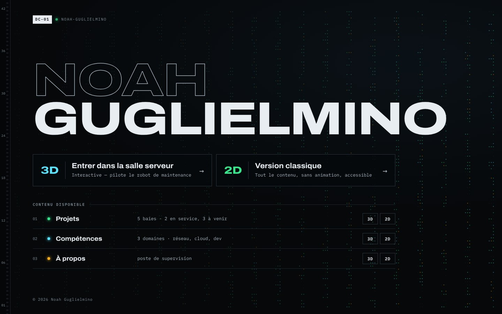
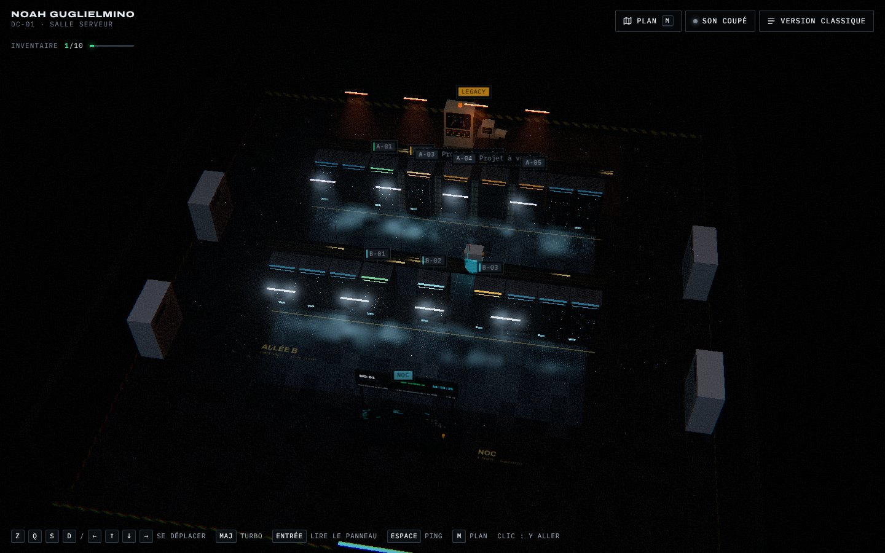

# DC-01 — portfolio de Noah Guglielmino

Un portfolio à explorer comme une **salle serveur** : tu pilotes un petit robot de maintenance
entre les baies, chaque baie est un projet ou une compétence, le poste de supervision raconte
qui je suis, et le CV tourne encore sur un vieux serveur legacy au fond de la salle.


| Accueil | Vue d'ensemble |
| --- | --- |
|  |  |

Trois pages, une seule source de données :

| Page | Rôle |
| --- | --- |
| `/` | Accueil : uniquement le nom et le contenu disponible, deux façons d'entrer (3D ou classique). |
| `/3d/` | La salle serveur interactive (Three.js, chargée seulement ici). |
| `/classique/` | Version 2D complète, HTML statique généré au build, lisible sans JavaScript. |

---

## Lancer en local

```bash
npm install
```

```bash
npm run dev
```

Puis ouvre http://localhost:5173.

```bash
npm run build && npm run validate
```

`validate` passe `html-validate` et le validateur officiel du W3C (Nu, nécessite Java) sur `dist/`.

## Ajouter / modifier un projet

Tout le contenu vit dans `src/data/` — **la scène ne se touche jamais** :

| Fichier | Contenu |
| --- | --- |
| `src/data/projects.ts` | Une entrée = une baie dans l'allée A. La salle s'élargit toute seule. |
| `src/data/skills.ts` | Un domaine = une baie dans l'allée B ; une compétence = un serveur dans la baie. |
| `src/data/profile.ts` | Poste de supervision (À propos), liens, chemin du CV. |

```ts
// src/data/projects.ts
{
  id: 'mon-projet',               // aussi utilisé dans l'URL : /3d/#mon-projet
  title: 'Mon projet',
  status: 'online',               // 'online' (vert) | 'building' (ambre) | 'slot' (emplacement vide)
  hostname: 'mon-projet-prod-01', // étiquette de la baie
  tagline: 'Une phrase d’accroche.',
  description: 'Paragraphe 1.\n\nParagraphe 2.',
  context: 'SAE / alternance / perso',
  year: '2026',
  stack: ['Docker', 'Kubernetes'],
  highlights: ['Point clé 1', 'Point clé 2'],
  links: [{ label: 'Code source', url: 'https://github.com/…', kind: 'github' }],
},
```

Le CV est un simple fichier : remplace `public/cv/CV-Noah-Guglielmino.pdf`.

### À compléter (placeholders actuels)

- [ ] Textes, stack et liens d'**UbeRTaxi** et du **projet d'alternance** (`projects.ts`)
- [ ] Les 3 emplacements « Projet à venir » (passe-les en `online` quand ils existent)
- [ ] Niveaux de compétences (`skills.ts`) — listes indicatives
- [ ] Paragraphe « ce que je cherche », lien **LinkedIn**, **e-mail** (`profile.ts`)
- [ ] Le vrai **CV** en PDF (`public/cv/`)

## Dans la salle

| Action | Clavier | Souris / tactile |
| --- | --- | --- |
| Se déplacer | `ZQSD`, `WASD` ou flèches (AZERTY et QWERTY sans réglage) | glisser au doigt (joystick flottant) |
| Turbo | `Maj` | — |
| Aller vers une baie | `M` → plan de salle → `Entrée` | clic / tap sur la baie ou le sol |
| Lire le panneau | `Entrée` ou `E` | — |
| Fermer le panneau | `Échap` | bouton × |
| Ping | `Espace` | — |

Approche une baie : elle s'ouvre, ses serveurs glissent hors des rails et le panneau apparaît.
Il y a aussi un inventaire de visite, des liens directs vers chaque baie (`/3d/#ubertaxi`)… et une commande à ne pas taper.

## Sous le capot

- **Vite + TypeScript + Three.js** sans framework (le repo n'était pas en React → pas de R3F,
  bundle plus léger).
- **Zéro modèle, zéro texture à télécharger** : robot, baies, câbles et décor sont générés
  en code (low-poly) ; façades de serveurs, LEDs, sol technique et câbles lumineux sont
  dessinés dans les shaders ; écrans et étiquettes en Canvas 2D. Les polices sont auto-hébergées
  en woff2 (sous-ensembles chargés à la demande).
- **InstancedMesh** pour toutes les baies : 6 draw calls quel que soit le nombre de projets.
  Clignotement des LEDs 100 % GPU.
- **Physique maison** : cercle contre boîtes, avec glissement le long des obstacles.
  **Pathfinding A\*** sur grille de 25 cm pour le pilote automatique.
- **Post-process en une passe** : la scène est rendue en HDR (demi-flottants), le bloom
  (mêmes calculs que l'`UnrealBloomPass` de three.js) reste en petite résolution, puis une
  seule passe plein écran fait aberration chromatique, bloom, vignette, grain, tone mapping
  ACES et sRGB, directement dans le canvas. Sur un iGPU Intel : ~3 ms au lieu de ~8,5 ms.
- **Qualité adaptative** : objectif 60 fps, jamais sous 30. Le temps GPU est mesuré
  (`EXT_disjoint_timer_query_webgl2`, sinon les fps) et c'est d'abord la **résolution**
  qui s'adapte (de 100 % à 50 %, le navigateur agrandit le canvas), puis le bloom passe
  en plus basse définition et les effets volumétriques se coupent (le bloom reste toujours
  actif). Un **calibrage GPU** pendant l'écran de boot choisit la résolution de départ sur
  les vues les plus lourdes : pas de baisse de qualité visible après l'intro, et aucun
  shader recompilé en cours de visite.
  Une alerte propose la version classique si l'appareil n'arrive pas à suivre.
- **Moins de pixels ombrés pour rien**, à image identique au pixel près : three.js trie les
  objets opaques par matériau et non d'avant en arrière, donc l'ordre de dessin est imposé
  (sol et murs après ce qu'ils entourent, façades et chemins de câbles avant ce qu'ils cachent,
  pré-passe de profondeur derrière les serveurs) et les PointLight ne sont calculées que dans
  leur portée. Sur un iGPU Intel : −3 à −4 ms par image dans les allées.
- **Cadence régulière** : sur un écran 120/144 Hz, si le GPU est juste, une image sur deux (60/72 i/s stables
  plutôt qu'une alternance 7/14 ms) ; un GPU qui a de la marge garde la cadence native. Les écrans
  animés (Canvas 2D) se partagent un seul envoi au GPU par image.
- **Son 100 % Web Audio** (ventilation, ronflement 50 Hz, turbine du robot), coupé par défaut.
- **Écran de boot honnête** : chaque `[ OK ]` attend une vraie étape (import de three.js,
  polices, construction de la scène, compilation des shaders, calibrage du GPU).

Mesures (build de prod) :

| | |
| --- | --- |
| JS de l'accueil | ~3 Ko gzip |
| Chunk 3D (three.js inclus), chargé seulement dans `/3d/` | ~175 Ko gzip |
| Rendu de la salle | ~67 draw calls, ~7 300 triangles |

## Accessibilité et standards

- HTML **valide W3C** sur les trois pages (validateur Nu, 0 erreur) et `html-validate`.
- **0 violation axe-core** (WCAG 2.2 A/AA + bonnes pratiques), thèmes sombre et clair.
- Contrastes ≥ 4,5:1 sur tous les textes, dans les deux thèmes.
- Version classique **en un clic** depuis l'accueil, **proposée automatiquement** :
  - sans WebGL 2 : la 3D est désactivée sur l'accueil et `/3d/` redirige vers la version classique ;
  - avec `prefers-reduced-motion` : la version classique est mise en avant, et la salle affiche
    une porte d'entrée qui la recommande.
- Navigation clavier complète dans la 3D :
  - plan de salle en `<dialog>` natif ;
  - les panneaux sont du vrai HTML (titre focusable, région `aria-live`) ;
  - focus rendu à la fermeture.
- Le canvas est décoratif (`aria-hidden`) ; toute l'info existe en texte.
- Thème clair automatique et styles d'impression pour la version classique.

## Déploiement

Les chemins sont relatifs (`base: './'`) : le site marche sur GitHub Pages, Vercel, Netlify ou un domaine perso.

Le workflow `.github/workflows/deploy.yml` construit, valide et publie sur **GitHub Pages**
à chaque push sur `main`. À faire une seule fois : *Settings → Pages → Source : GitHub Actions*.

## Crédits

Three.js (MIT) · Archivo et IBM Plex Mono (SIL Open Font License) via Fontsource.
