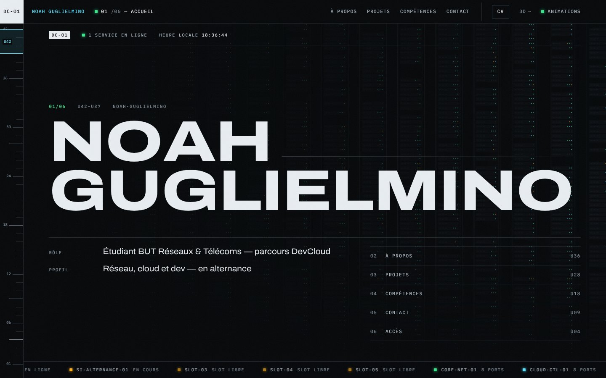
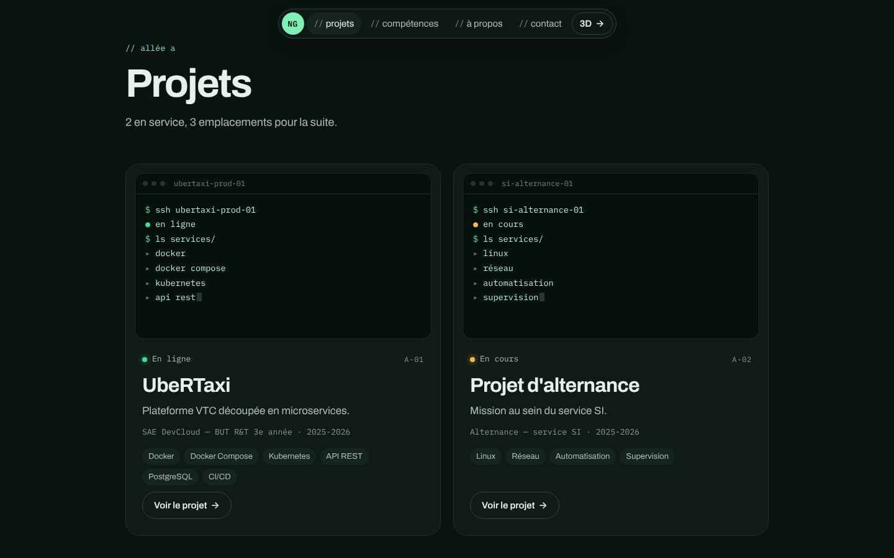
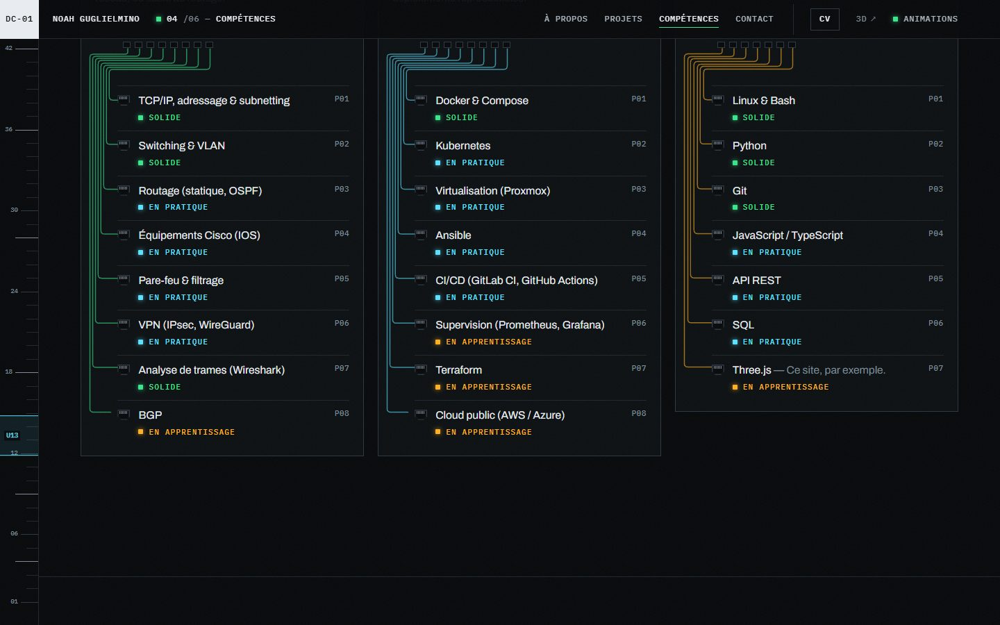
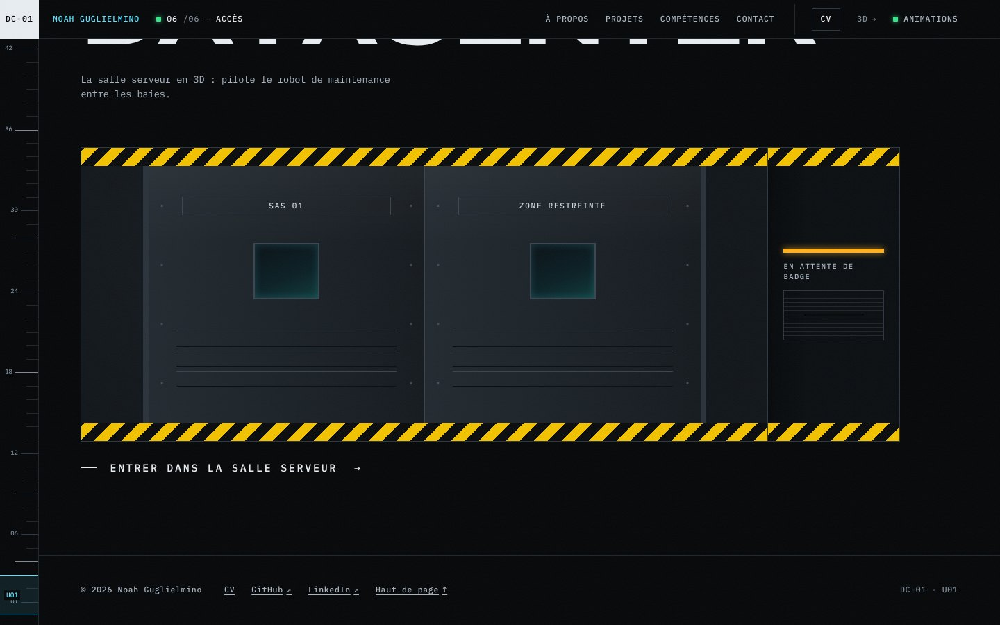

# DC-01 — portfolio de Noah Guglielmino

Un portfolio présenté comme une **salle serveur** : une page 2D éditoriale façon fiche technique
de matériel × écran de supervision (baies, LEDs, câbles de brassage, NOC), et au bout du couloir,
une porte de sas qui ouvre sur la **salle 3D** où l'on pilote un robot de maintenance.



| Allée A — projets | Panneau de brassage — compétences |
| --- | --- |
|  |  |

| Le sas vers la 3D | La salle 3D |
| --- | --- |
|  |  |

Quatre pages, une seule source de données :

| Page | Rôle |
| --- | --- |
| `/` | **La page 2D complète**, HTML pré-rendu au build depuis `src/data/`, animée ensuite. |
| `/cv/` | Le CV sur un « serveur legacy » (terminal ambre ; papier listing en thème clair). |
| `/3d/` | La salle serveur interactive (Three.js, chargée seulement ici). Accès : la porte en bas de `/`, ou le lien « 3D » du header. |
| `/classique/` | Ancienne adresse : redirige vers `/` (en gardant l'ancre `#projets`…). |

---

## Lancer en local

```bash
npm install
npm run dev        # http://localhost:5173
```

## Vérifier (avant chaque commit)

```bash
npm run build          # tsc --noEmit + vite build
npm run validate       # html-validate + validateur W3C Nu (Java 11 ou plus)
npm run budget         # JS de la page 2D, gzip, librairies comprises (échoue > 80 Ko)
npm run a11y           # axe-core sur / et /cv/, thèmes sombre et clair, avec et sans animations
npm run shots          # captures 1440×900, 390×844, reduced-motion, sans JS → ./shots/
npm run lighthouse     # Lighthouse desktop sur / et /cv/
```

`a11y`, `shots` et `lighthouse` pilotent le Edge ou le Chrome **déjà installé** (aucun navigateur
téléchargé) ; un autre chemin se donne avec `BROWSER_PATH=…`. Le site est servi sous `/portfolio_3d/`,
comme sur GitHub Pages.

## Ajouter / modifier un projet

Tout le contenu vit dans `src/data/` — **ni la page 2D ni la scène 3D ne se touchent** :

| Fichier | Contenu |
| --- | --- |
| `src/data/projects.ts` | Une entrée = une lame dans l'allée A (2D) et une baie dans la salle (3D). |
| `src/data/skills.ts` | Un domaine = un panneau de brassage (2D) / une baie (3D) ; une compétence = un port. |
| `src/data/profile.ts` | Hero, poste de supervision (À propos), contact, CV. |

```ts
// src/data/projects.ts
{
  id: 'mon-projet',               // ancre de la fiche : /#mon-projet (2D) et /3d/#mon-projet
  title: 'Mon projet',
  status: 'online',               // 'online' (LED verte) | 'building' (ambre) | 'slot' (baie vide)
  hostname: 'mon-projet-prod-01', // étiquette de la lame
  tagline: 'Une phrase d’accroche.',
  description: 'Paragraphe 1.\n\nParagraphe 2.',
  context: 'SAE / alternance / perso',
  year: '2026',
  stack: ['Docker', 'Kubernetes'],
  highlights: ['Point clé 1', 'Point clé 2'],
  links: [{ label: 'Code source', url: 'https://github.com/…', kind: 'github' }],
},
```

Tout le reste suit : nombre de baies, compteurs du NOC, topologie réseau, bandeau d'état, POST
de démarrage, longueur du défilement horizontal, câbles de brassage. Le CV est un simple fichier :
remplace `public/cv/CV-Noah-Guglielmino.pdf` (son poids est relu au build).

### À compléter (placeholders actuels)

- [ ] Textes, stack et liens d'**UbeRTaxi** et du **projet d'alternance** (`projects.ts`)
- [ ] Les 3 emplacements « Projet à venir » (passe-les en `online` quand ils existent)
- [ ] Niveaux de compétences (`skills.ts`) — listes indicatives
- [ ] Paragraphe « ce que je cherche », lien **LinkedIn**, **e-mail** (`profile.ts`)
- [ ] Le vrai **CV** en PDF (`public/cv/`, le fichier actuel fait 1 Ko)

## Structure

```
index.html               coquille de /  (<!--SITE--> remplacé au build)
cv/index.html            coquille de /cv/
classique/index.html     redirection vers /
3d/index.html            la salle 3D
src/data/                SEULE source de contenu
src/render/              rendu HTML statique, exécuté par Vite (Node) au build
  site.ts                  toutes les sections de /
  cv.ts                    /cv/
  shared.ts                statuts, codes d'inventaire, texte découpé pour les révélations
src/site/                page 2D côté navigateur
  boot.ts                  chargé tout de suite, sans librairie (~4 Ko gzip)
  sheet.ts                 fiche projet (<dialog> + View Transitions)
  patch.ts                 géométrie des câbles de brassage
  wall.ts                  mur de baies du hero (Canvas 2D)
  motion.ts, motion/       motion design (GSAP + ScrollTrigger + Lenis), chargé en import() dynamique
  styles/                  un fichier par section + fx.css (états d'animation) + print.css
src/cv/                  styles de /cv/ (aucun JS utile)
src/three/               la salle 3D
scripts/                 vérifications (captures, axe, Lighthouse, budget)
```

## La page 2D

### Sections

| # | Section | Grammaire datacenter |
| --- | --- | --- |
| — | Préchargement | POST de serveur (première visite, ≤ 1,2 s), passable avec Entrée, Échap, Espace ou un clic. |
| 01 | Hero | Nom révélé lettre par lettre par une scanline ; mur de baies aux LEDs vivantes, en parallaxe ; barre d'état (DC-01 · services en ligne · heure réelle) ; bandeau d'état qui défile. |
| 02 | À propos = NOC | Facts en tuiles, terminal `whoami` qui se tape, compteurs, topologie réseau où circulent des paquets. |
| 03 | Projets = allée A | Une lame de serveur par projet (A-01…), LED et statut écrit ; baies vides à LED ambre qui pulse ; fiche détaillée en `<dialog>`. |
| 04 | Compétences = brassage | Un port RJ45 par compétence, niveau écrit en toutes lettres ; câbles qui se tracent au scroll ; survol ou focus d'un port → son câble s'allume. |
| 05 | Contact = ticket | mailto, liens, copie de l'e-mail avec toast annoncé aux lecteurs d'écran, lien vers le CV. |
| 06 | Accès au datacenter | Porte de sas, bandes de chantier, lecteur de badge ; au clic, ouverture puis extinction cathodique, puis `./3d/?choix=3d`. |

Un rail de baie fixe (U42 → U01) suit la progression, et le header indique la section courante
(`03/06 — PROJETS`). Il y a 6 sections et non 7 : le préchargement n'en est pas une.

### Motion design

| Effet | Technique |
| --- | --- |
| Révélation du nom | Un bloc de « déchiffrement » balaie chaque lettre au passage de la scanline (le délai suit la position x réelle de la lettre). |
| Titres de section | Scanline verticale, puis caractères en cascade ; métadonnées mono déchiffrées. |
| Terminal | Frappe **100 % transform** : un cache se déplace par paliers `steps(n)` au-dessus d'un texte déjà présent. |
| Compteurs | De 00 à N, chiffres tabulaires (aucun saut de largeur). |
| Paquets réseau | Chemins échantillonnés en keyframes `translate` (Web Animations API) : composités, aucun JS par image. |
| Allée A (desktop) | `position: sticky` + translation horizontale liée au scroll ; chaque lame sort du rack et sa LED s'allume. |
| Fiche projet | View Transitions API (la lame se transforme en fiche) ; sinon une courte animation transform/opacity. |
| Câbles | `stroke-dashoffset` lié au scroll (seule exception à « transform + opacity » : petit SVG, aucun recalcul de mise en page). |
| Porte du sas | Vantaux en translate, lueur en opacity ; extinction cathodique par deux volets et une ligne qui se réduit en point. |
| Réticule | Suit le pointeur avec ses coordonnées de page ; seulement avec un pointeur fin, **sans jamais masquer le curseur natif**. |
| Divers | Boutons magnétiques, header dont le numéro « roule », grain très léger, scroll fluide (Lenis). |

**Règles.** Seules `transform` et `opacity` sont animées, sauf le tracé des câbles. Tout ce qui
boucle se met en pause hors écran (IntersectionObserver), quand l'onglet est caché, ou avec le
bouton **« Animations »** du header (mémorisé), qui répond au critère WCAG 2.2.2.

- **`prefers-reduced-motion`** : aucun mouvement (ni scroll fluide, ni défilement horizontal, ni
  parallaxe, ni déchiffrement). GSAP et Lenis ne sont pas chargés. La page reste complète, avec
  un mur de baies figé.
- **Mobile** : pile verticale (pas de défilement horizontal), pas de réticule ni d'aimants,
  scroll natif, moins de LEDs (20 i/s), topologie en bus vertical.

### Décisions

- **Le HTML est complet sans JS.** Tout est pré-rendu ; le JS ne fait qu'ajouter des
  comportements. Un petit script inline dans `<head>` (< 0,5 Ko) décide **avant le premier
  rendu** de l'état des animations et du POST : aucun décalage visible.
- **Le LCP n'attend pas le JS.** Le nom est peint dès la première image. Les éléments cachés pour
  être révélés ont un **filet de sécurité CSS** : ils réapparaissent seuls si le JS d'animation ne
  se charge pas.
- **Accessibilité des textes animés.** Le vrai texte reste dans le DOM (`.sr-only`) ; seule une
  copie `aria-hidden` est découpée en caractères ou brouillée.
- **Épinglage en `position: sticky`** plutôt qu'avec le `pin` de ScrollTrigger : le passage en
  `position: fixed` comptait comme un décalage de mise en page (CLS mesuré à 1,6 → 0).
- **Pas de SplitText** : le découpage se fait au build (0 Ko de JS, aucun décalage). GSAP et
  Lenis sont installés par npm et regroupés dans un chunk chargé après le premier rendu.
- **Polices** : Archivo variable (largeur 125 % pour les titres) et IBM Plex Mono 400/500,
  sous-ensembles latins préchargés. Aucune ressource externe.
- **Aucun chiffre inventé** : les compteurs, le bandeau, le POST et la topologie sont calculés
  depuis `src/data/`. Seuls des repères d'interface (U42, A-01, P01, « Slot libre »…) sont ajoutés.
- **Sans WebGL 2** : la porte reste fermée (le lien est retiré, ce n'est plus un lien), avec un
  message clair, et le lien « 3D » du header disparaît. `/3d/` sans WebGL renvoie sur `/` avec un avis.

### Mesures (build de prod, Edge 158, desktop)

| | |
| --- | --- |
| Lighthouse `/` | Performance 99 · Accessibilité 100 · Bonnes pratiques 100 · SEO 100 |
| Lighthouse `/cv/` | 100 · 100 · 100 · 100 |
| LCP / CLS / TBT (`/`) | 0,4–0,7 s · 0 · 0–30 ms |
| JS de la page 2D (tout compris) | 58 Ko gzip (budget 80) : 4 Ko au chargement, le reste après le premier rendu |
| CSS de la page 2D | ~10 Ko gzip |
| axe-core | 0 violation sur `/` et `/cv/`, sombre et clair, avec et sans animations |

## Dans la salle (3D)

| Action | Clavier | Souris / tactile |
| --- | --- | --- |
| Se déplacer | `ZQSD`, `WASD` ou flèches (AZERTY et QWERTY sans réglage) | glisser au doigt (joystick flottant) |
| Turbo | `Maj` | — |
| Aller vers une baie | `M` → plan de salle → `Entrée` | clic / tap sur la baie ou le sol |
| Lire le panneau | `Entrée` ou `E` | — |
| Fermer le panneau | `Échap` | bouton × |
| Ping | `Espace` | — |

Approche une baie : elle s'ouvre, ses serveurs glissent hors des rails et le panneau apparaît.
Il y a aussi un inventaire de visite, des liens directs vers chaque baie (`/3d/#ubertaxi`)… et une commande à ne pas taper.

## Sous le capot (3D)

- **Vite + TypeScript + Three.js** sans framework (le repo n'était pas en React → pas de R3F,
  bundle plus léger).
- **Zéro modèle, zéro texture à télécharger** : robot, baies, câbles et décor sont générés
  en code (low-poly) ; façades de serveurs, LEDs, sol technique et câbles lumineux sont
  dessinés dans les shaders ; écrans et étiquettes en Canvas 2D. Les polices sont auto-hébergées
  en woff2 (sous-ensembles chargés à la demande).
- **InstancedMesh** pour toutes les baies : 5 draw calls quel que soit le nombre de projets.
  Clignotement des LEDs 100 % GPU.
- **Physique maison** : cercle contre boîtes, avec glissement le long des obstacles.
  **Pathfinding A\*** sur grille de 25 cm pour le pilote automatique.
- **Post-process** : bloom en demi-résolution, vignette, grain. **Qualité adaptative**
  sur 3 niveaux selon les fps mesurés (résolution, bloom, effets volumétriques).
  Une alerte propose la version 2D si l'appareil n'arrive pas à suivre.
- **Son 100 % Web Audio** (ventilation, ronflement 50 Hz, turbine du robot), coupé par défaut.
- **Écran de boot honnête** : chaque `[ OK ]` attend une vraie étape (import de three.js,
  polices, construction de la scène, compilation des shaders).

> Une réécriture « perf » du post-process 3D a été tentée (commit `6dcc2c0`) puis retirée :
> hors périmètre de la refonte 2D, et rendu flou (résolution tombée à 50 %) sur les machines lentes.
> Elle reste récupérable dans l'historique git si on veut la retravailler dans une PR dédiée.

| | |
| --- | --- |
| Chunk 3D (three.js inclus), chargé seulement dans `/3d/` | ~173 Ko gzip |
| Rendu de la salle | ~67 draw calls, ~7 300 triangles |

## Accessibilité et standards

- HTML **valide W3C** sur toutes les pages (validateur Nu, 0 erreur) et `html-validate`.
- **0 violation axe-core** (WCAG 2.2 A/AA + bonnes pratiques), thèmes sombre et clair.
- Contrastes ≥ 4,5:1 sur tous les textes, dans les deux thèmes.
- Page 2D :
  - landmarks (`header`, `nav` ×2 nommées, `main`, `footer`), un `h1`, un `h2` par section ;
  - lien d'évitement ; les ancres internes donnent le focus au titre de la section ;
  - chaque compétence est focusable (son câble s'allume au focus) ;
  - dans l'allée épinglée, une lame qui reçoit le focus est amenée à l'écran ;
  - la fiche projet est un `<dialog>` natif : focus sur le titre, `Échap`, focus rendu au bouton ;
  - aucune information portée seulement par la couleur : chaque LED a son texte (« En ligne »,
    « En pratique », « Badge accepté »…) ;
  - tout le décor (canvas, rail, bandeau, câbles, réticule, grain) est `aria-hidden` ;
  - bouton « Animations » pour arrêter tout ce qui bouge seul (WCAG 2.2.2).
- Navigation clavier complète dans la 3D (plan de salle en `<dialog>`, panneaux en vrai HTML,
  focus rendu à la fermeture).
- Thème clair automatique (`prefers-color-scheme`) et styles d'impression sur `/` et `/cv/`.

## Déploiement

Les chemins sont relatifs (`base: './'`) : le site marche sur GitHub Pages, Vercel, Netlify ou un domaine perso.

Le workflow `.github/workflows/deploy.yml` construit, valide (HTML + budget JS) et publie sur
**GitHub Pages** à chaque push sur `main`. À faire une seule fois : *Settings → Pages → Source : GitHub Actions*.

## Crédits

Three.js (MIT) · GSAP (licence standard « no charge » de GreenSock/Webflow) · Lenis (MIT) ·
Archivo et IBM Plex Mono (SIL Open Font License) via Fontsource.
